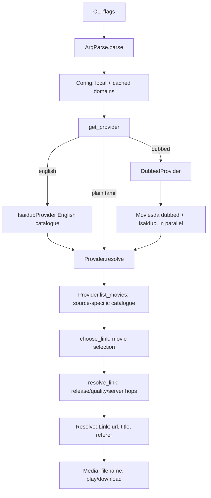

# Architecture

Source of truth: `main.py`, `src/*.py`, `src/providers/**`, `pyproject.toml`.

## Entry point

`pyproject.toml` registers `eiga-cli = "main:main"`. `main.py` also calls `main()`
under `if __name__ == "__main__"`.

`main()` does the following, in order:

1. `ArgParse().parse()` — parsing/validation happens before any network access
   (`--help` exits here).
2. `Config()` — loads local/cached settings.
3. `config.fetch_config()` — optional remote domain refresh; a failure prints
   `Remote config unavailable; using saved domains.` and continues.
4. `asyncio.run(run(args, config))`.
5. It catches `KeyboardInterrupt` (returns 130) and `(ScrapeError, ValueError)`
   (prints in red, returns 1).

`run()` builds the provider through
`get_provider(config, dubbed=args.dubbed, english=args.english)`, creates
`ProviderRequest(query=args.query, year=args.year, latest=args.latest,
english=args.english)`,
and opens one `httpx.AsyncClient(follow_redirects=True, timeout=30,
headers=config.headers)` for the whole resolution. It then calls
`await provider.resolve(client, request)`.

After resolution, `run()` copies `config.headers`, adds `Referer` from
`ResolvedLink.referer` when present, and adds `Cookie` from the client's cookie
jar when one matches the final URL. It constructs
`Media(resolved.url, resolved.title, config.download_path, headers)` and returns
`0` or `1` from `media.process(args.download)`. `src/media.py` itself is
unchanged by the provider refactor.

## Request flow

The provider boundary is the final media URL. Everything up to and including
the interactive selection lives in `src/providers/`; everything after it lives
in `src/media.py`.

## Module map

| File | Responsibility (as implemented) |
| --- | --- |
| `main.py` | Entry point, provider selection, header/cookie assembly, exit codes |
| `src/argparser.py` | `argparse` definition and flag-combination validation |
| `src/config.py` | Defaults, local/remote config loading, domain validation, path derivation |
| `src/cache.py` | Short-lived catalogue and release-choice cache (best effort) |
| `src/logger.py` | Timestamped append-only log of config/fetch failures |
| `src/media.py` | Safe filenames, VLC/yt-dlp/ffmpeg/browser handoff |
| `src/scraper.py` | Bounded HTTPS fetch, HTML parsing, link/choice discovery, `Link`/`Page` |
| `src/utils.py` | URL canonicalization and text filters |
| `src/providers/base.py` | Shared provider contract and shared resolution flow |
| `src/providers/moviesda/provider.py` | Moviesda catalogue, latest releases and dubbed catalogue |
| `src/providers/isaidub/provider.py` | Isaidub dubbed and English catalogue listing/search |
| `src/providers/dubbed/provider.py` | `--dubbed`: merges moviesda + isaidub into one tagged list |

## Fetching and security rules in `src/scraper.py`

- `Scraper.fetch_page()` rejects non-HTTPS input via `secure_url(url, url)`.
- It makes at most two attempts. Transport errors and HTTP statuses
  `429, 500, 502, 503, 504, 520, 521, 522, 523, 524` are retried once after a
  0.4 s sleep; other failures raise `ScrapeError`.
- `_fetch_once()` follows redirects manually, up to `REDIRECT_LIMIT = 10`, and
  validates each target with `secure_url()`. Redirects whose target is already
  a media file return immediately without opening the large response.
- HTML bodies are capped at `PAGE_LIMIT = 2_000_000` bytes.
- `Page.is_hls` checks `mpegurl` in the content type or a `.m3u8` path;
  `Page.is_media` excludes HTML, HLS and `text/plain`, then accepts video media
  types or common media file suffixes.
- `Link` is the small data carrier used throughout: `title`, `url`, `referer`.

## Link discovery helpers

`Scraper.links()` filters anchors through `secure_url()` and `is_valid()`.
On top of it:

- `entries()` reads `.f`/`.folder` anchors and drops social/share titles.
- `pages()` reads `.pagination`/`.pagecontent`/`rel=next` anchors from the same
  host and recognizes numeric or `page=` links.
- `choices()` tries, in order: `.dlink`/`a.coral` download links, folder
  entries, then broader button/anchor/media/meta/form/script/iframe heuristics.
- `latest()` reads `div.latest` cards on the moviesda home page.

## Caching (`src/cache.py`)

`CatalogueCache` stores `list[Link]` as JSON under a SHA-256 filename derived
from the key. Keys used by the providers are the catalogue `start` URL and
`first_page.url + "#release-choices"`. Entries expire after 15 minutes; files
over 2 MB, mismatched URLs, bad JSON and partial listings are not used or saved.
All cache I/O is wrapped so failures are ignored.

## Logging (`src/logger.py`)

`Logger.log()` appends `[YYYY-MM-DD HH:MM:SS] message` to
`$XDG_CACHE_HOME/eiga-cli/logs.txt` (default `~/.cache/eiga-cli/logs.txt`),
creating directories as needed and ignoring write errors. This path uses
`XDG_CACHE_HOME` on all platforms; it does not use `LOCALAPPDATA` (unlike
`Config`, see [configuration.md](configuration.md)).
